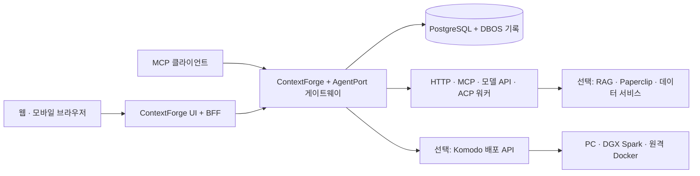

# AgentPort Gateway

> 여러 장치에 배치한 AI 서비스와 에이전트를 등록하고, 사용자별 권한에 따라 웹·메신저·MCP에서 호출하며, 서비스 수명주기와 실행 흐름을 시각적으로 제어하는 자체 호스팅 중앙 게이트웨이.

**0.1.0 초기 개발 버전. 웹·MCP가 첫 구현 범위이며 메신저는 후속 단계입니다.**

AgentPort의 중심은 독립 게이트웨이입니다. 대시보드는 서비스를 관리하고 실행하는 화면입니다. Paperclip, Slack, 별도 메신저는 연결 가능한 서비스이며 로그인이나 자체 워크플로우의 필수 구성요소가 아닙니다.

운영자는 PC·DGX Spark·원격 장치에 배포한 서비스를 등록하고 권한, 실행 정책, 업데이트를 관리합니다. 일반 사용자는 허용된 도구나 에이전트를 골라 요청과 파일을 전달하고 결과를 받습니다. Docker 명령이나 모델 배포 방법을 알 필요가 없습니다.

## 사용 경로

- **파일 변환:** 텍스트 파일 선택 → 서비스 실행 → 진행 상황 확인 → CSV 다운로드. 다른 브라우저에서 같은 계정으로 작업을 계속 확인할 수 있습니다.
- **에이전트 작업:** 런타임·모델·페르소나·허용 도구·도구 호출 한도를 설정하고 새 세션 또는 기존 세션을 선택합니다.
- **작성과 검수:** 그래프에서 작성자와 검수자를 지정하고 선택한 파일의 스냅샷을 전달합니다. 수정 반복은 기본 최대 3회이며, 클라우드 요청마다 승인을 요구하도록 설정할 수 있습니다.
- **민감 데이터 처리:** 로컬 서비스가 선택한 출력만 승인 노드로 전달하고, 승인한 정확한 입력만 외부 단계에 보냅니다. 자동 익명화 모델 자체는 포함하지 않습니다.
- **서비스 운영:** 상시 실행·요청 시 실행·수동 실행을 구분하고, 사용 중 종료·업데이트를 막습니다. Komodo가 실제 Docker 작업을 수행합니다.

## 구현 및 검증 상태

| 영역 | 현재 상태 |
|---|---|
| ContextForge 로그인, 사용자·프로젝트 경계, 비공개 실행·결과 | 실제 HTTP 로그인 및 두 사용자 격리 테스트 |
| REST `/orchestration/v1`, MCP SDK 엔드포인트 | 실제 MCP 초기 연결·도구 호출 테스트 |
| 비동기 작업, 병렬·합류·조건·승인, 그래프 버전 고정 | DBOS 실행 및 실제 서버 테스트 |
| 재시작 복구와 중복 실행 방지 | 승인 대기 중 프로세스 강제 종료·재시작 테스트 |
| 단일 기동, 사용 중 보호, 유휴 중지, 실패 시 배포 복구 | 동시성·모의 Komodo 계약 테스트; 실제 장치 검증은 별도 |
| Codex·Claude ACP | 실제 초기 연결 확인, 모의 ACP 프로세스로 세션·재개 검증; 유료 추론 미검증 |
| React Flow 대시보드, 기존 로그인 BFF | 빌드·회귀 테스트; 상세 결과는 검증 문서 |
| Docker Compose, PostgreSQL, 원격 PC·DGX GPU | 배포 구성 제공; 검증한 환경만 검증 문서에 기록 |
| Paperclip·RAG·OpenAI 호환 API·HTTP/MCP 도구 | 선언형 연결 계약. 해당 제공자별 전체 기능 검증을 의미하지 않음 |
| Hermes·OpenClaw·Kimi, 메신저 | 전용 어댑터 미구현. HTTP/MCP로 이미 노출된 기능은 일반 서비스로 연결 가능 |

[검증 기록](docs/validation.md)에서 실제 실행한 항목과 미검증 항목을 구분합니다. 보안 감사 완료나 인터넷 공개형 다중 고객 격리를 주장하지 않습니다.

## 빠른 시작: Docker Compose

Docker Engine + Compose v2가 필요합니다. 게이트웨이 자체에는 GPU가 필요하지 않습니다.

```bash
git clone https://github.com/jiwoosong/agentport-gateway.git
cd agentport-gateway
python3 scripts/init-compose.py
docker compose --profile demo up -d --build
```

`.env`를 로컬에서 열어 초기 관리자 계정과 임의 생성된 비밀번호를 확인합니다. 이 파일을 Git에 올리지 마세요. `http://localhost:3000/app/orchestration`에서 로그인하고 초기 비밀번호 변경을 완료합니다.

**Register service**에서 [변환 서비스 정의](examples/converter.service.json)를 등록합니다. **Use service**로 텍스트나 파일을 전달하고 실행합니다. Activity에서 결과를 다운로드합니다. 이 예제는 네트워크가 격리된 변환 컨테이너를 수동 실행 상태로 연결합니다.

요청 시 기동·원격 Docker 운영은 [Komodo 설정](docs/deployment.md#komodo와-원격-장치)을 완료한 뒤 서비스에 `stack_id`, `health_url`, `lifecycle: on_demand`를 설정합니다. 이미지 다운로드·최초 배포는 운영자가 수행합니다.

## 소스 개발

Python 3.12–3.14, Node.js 24, uv를 사용합니다. SQLite는 단일 프로세스 개발용입니다.

```bash
uv sync --frozen --extra dev
uv run aog init
uv run aog serve
```

별도 터미널에서 UI와 BFF를 실행합니다.

```bash
cd dashboard
npm ci --ignore-scripts
npm run build
cd server
npm ci --ignore-scripts
npm run build
COOKIE_SECURE=false REDIS_URL=memory:// PUBLIC_ORIGIN=http://localhost:3000 npm start
```

초기화 명령은 기존 `.env`를 덮어쓰지 않습니다. 소스 개발과 Compose 구성을 전환할 때 데이터베이스와 비밀 키를 함께 보존하세요. [상세 설치](docs/deployment.md)

## 구성과 독립성



ContextForge의 인증·권한·프록시를 재사용하고 자체 테이블·경로·실행 코드를 추가합니다. DBOS는 애플리케이션 내 라이브러리이며 외부 관리 서비스가 필요하지 않습니다. 중앙은 추론이나 팀 구성을 임의로 결정하지 않습니다. 사용자 그래프와 명시적인 권한·수명주기 규칙만 실행합니다.

서비스·에이전트·그래프는 `schema_version: 1` JSON/YAML로 내보냅니다. 일반 HTTP/MCP 서비스 추가에 중앙 코드 수정이 필요하지 않습니다. ContextForge에 대한 실행 의존은 있지만 정의와 어댑터 계약은 독립적으로 보존합니다.

## 접근과 데이터 경계

초기 대상은 신뢰하는 운영자가 관리하는 소규모 팀입니다. 외부 접속은 **HTTPS + 사설망/VPN**을 기본으로 합니다. 같은 계정으로 여러 PC·모바일 브라우저에서 로그인할 수 있으며 작업은 브라우저 연결과 독립적으로 실행됩니다.

사용자와 프로젝트는 ContextForge 계정·팀에 대응합니다. 서비스 사용과 설치·업데이트 권한은 분리됩니다. 일반 사용자와 에이전트에는 Docker 소켓을 제공하지 않습니다. 호스트 운영자는 데이터베이스와 런타임에 접근할 수 있는 신뢰 주체입니다.

`local_only`는 외부 호출 차단과 **운영자가 실제로 격리한 실행 네트워크**를 함께 요구합니다. 플래그만으로 컨테이너 네트워크를 격리하지 않습니다. 클라우드나 외부 메신저에 전달한 내용은 해당 제공자가 처리합니다. RAG의 원본 문서 ACL도 검색 서비스가 검증해야 합니다. [보안 경계](docs/security.md)

## 범위 밖

새 메신저, 범용 에이전트 하네스, 자체 이미지·영상 모델, VM 하이퍼바이저, 원격 데스크톱 엔진은 만들지 않습니다. 추론·계획·개인 메모리·스킬 학습은 각 하네스에 둡니다. 공유 스킬·지식은 별도 RAG/게시 서비스에서 명시적으로 게시합니다. 중앙은 자동으로 모든 대화를 수집하거나 학습시키지 않습니다.

## 문서와 검증

- [아키텍처·복구·권한](docs/architecture.md)
- [재사용 범위·버전·라이선스](docs/reuse-and-compatibility.md)
- [설치·HTTPS·PC/DGX·업데이트·백업](docs/deployment.md)
- [서비스·그래프·MCP 계약](docs/contracts.md)
- [검증 기록과 제한](docs/validation.md)
- [기여 안내](CONTRIBUTING.md), [보안 보고](SECURITY.md), [Apache-2.0](LICENSE), [출처 고지](NOTICE)

```bash
uv run pytest -q
AOG_INTEGRATION=1 uv run pytest tests/test_http_integration.py -q
cd dashboard
npm test -- --maxWorkers=2
```
