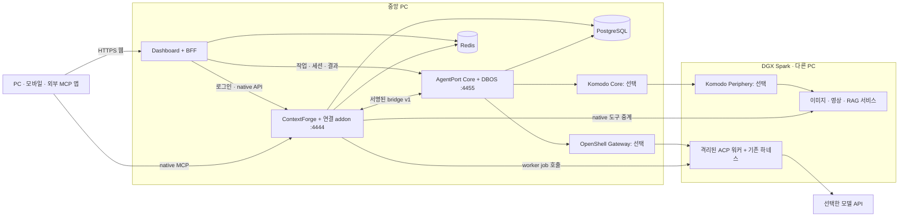
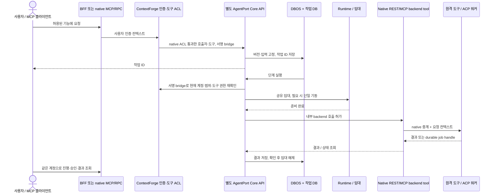
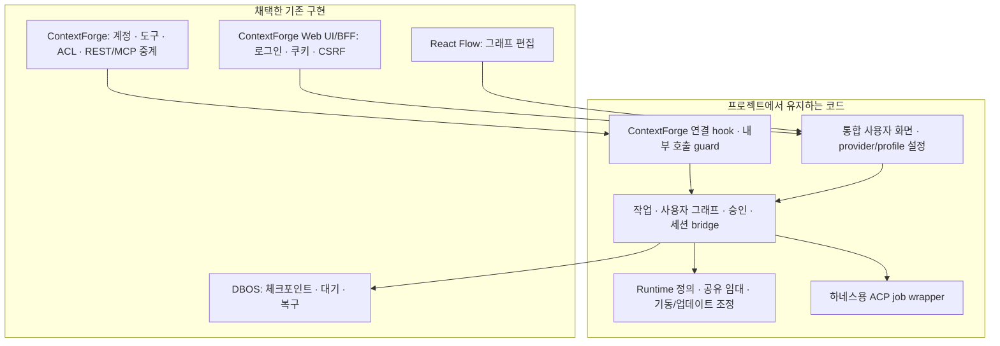

# Architecture

AgentPort는 독립 Core API와 교체 가능한 게이트웨이 연결로 구성합니다. 기본 연결은 별도 ContextForge 호환 구성요소입니다. 기존 인증·도구 등록·REST/MCP 중계를 실제 호출 경로에 사용하며 Core가 수명주기·장시간 작업·세션·사용자 그래프를 관리합니다. 실행 엔진은 Core 안의 **DBOS 하나**입니다. Core의 실행 경로는 mcpgateway ORM·애플리케이션·hook을 import하지 않습니다.

## Deployment

DGX·OpenShell·Komodo는 배치 선택지입니다. 기본 Compose는 gateway, core, PostgreSQL, dashboard/BFF, Redis를 실행합니다. 이전 단일 앱보다 Python 프로세스가 하나 늘어났으며 경량성 개선을 측정 없이 주장하지 않습니다. `image-demo`는 CPU 이미지 변환기 한 개를 더합니다. PC와 Spark의 CPU 아키텍처·드라이버·GPU 런타임은 운영자가 별도로 검증합니다. 여러 장치를 연결하는 것과 GPU 스케줄링은 다릅니다.

## Ownership

| 자원 | 관리 주체 | AgentPort에서 유지하는 내용 |
|---|---|---|
| 계정·팀·역할·API 토큰 | ContextForge | 실행 당시 제한된 호출자 컨텍스트. 별도 비밀번호 DB 없음 |
| 도구 이름·스키마·주소·공개 범위·중계 설정 | ContextForge Tool | native tool ID와 runtime의 연결. 별도 활성 서비스 레지스트리 없음 |
| Runtime | AgentPort | 실행 위치, backend target, 실행 정책, 용량, 릴리스, 상태·임대 |
| Provider connection | AgentPort | API 프로토콜·base URL·모델·개인 credential 참조 |
| Agent profile | AgentPort | 하네스 종류, runtime, provider 또는 native login 참조, persona·허용 도구 |
| 네이티브 로그인·추론·계획·메모리·스킬 | 각 하네스 | 중앙에는 opaque 프로필 참조만 저장 |
| 그래프·작업·단계·승인·결과 | Core + DBOS | 버전 고정 정의, 명시적 입력, 체크포인트와 실행 결과 |
| 세션 | 중앙 레코드 + 전용 워커/하네스 | 소유자·프로젝트·profile과 native session의 매핑 |
| 컨테이너 배포·실제 프로세스 상태 | Komodo/OpenShell 또는 운영자 | 외부 상태를 확인한 중앙 상태. 배포 성공과 작업 완료는 구분 |
| 장시간 ACP 작업 | 전용 ACP 워커 | 영속 SQLite job ID, native session, 승인 요청과 결과 |

같은 Docker 서비스의 여러 기능은 **같은 runtime_id**를 참조합니다. 사진 변환·크기 조회가 같은 컨테이너에 있으면 임대와 시작 잠금도 한 묶음입니다. A가 끝나도 B가 실행 중이면 해당 runtime을 중지할 수 없습니다. 같은 Komodo target 또는 OpenShell sandbox를 별도 임대 풀에 중복 등록하는 것은 거부합니다.

## Native Gateway Path

관리 도구는 native Tool에 공개 local 도구와 비공개 backend 도구를 등록합니다. 공개 도구는 작업을 제출하고 backend는 ContextForge의 기존 중계를 사용합니다. 이는 별도 서비스 카탈로그가 아니라 **하나의 기능에 대한 정책 입구와 네트워크 실행 대상**입니다.

게이트웨이 연결의 native dispatcher는 내부 backend 직접 호출을 거부하고 해당 작업 실행 중에만 허용합니다. 검증한 native caller·scope를 서명된 bridge로 Core에 전달하며 Core의 REST 요청도 같은 native 도구 정책 경로로 제출합니다. UI 숨김만으로 우회를 막는 방식이 아닙니다. 일반 native 도구를 별도로 등록하면 AgentPort 수명주기·승인 정책이 붙지 않습니다. 정책이 필요한 서비스를 두 번째 무제한 URL로 노출하지 않도록 운영자가 구성해야 합니다. 대상 서비스 자체의 다른 접속 경로까지 중앙이 차단하지는 않습니다.

MCP는 ContextForge의 `/mcp` 및 native virtual server 경로를 사용합니다. 별도 AgentPort MCP 서버·접속점은 없습니다. AgentPort 제어 도구는 native 목록에서 발견합니다. `/orchestration/v1`은 관리·작업 REST 경로이고 BFF에서는 `/api/orchestration/v1`로 접근합니다.

## Reuse Boundary

`mcpgateway.agentport` hook, local integration 타입, 내부 backend guard는 **선택 연결 패키지가 유지하는 호환 패치**입니다. ContextForge 1.1.0의 공개 upstream 기능이 아니며 stock CPEX만으로 구현했다고 주장하지 않습니다. [연결 패치 기록](upstream-contextforge.md)에 기준과 파일별 책임을 기록합니다. Windmill은 UX/운영 방식 참고 대상이며 코드나 실행 의존성을 포함하지 않습니다.

## Authorization and Data

native 인증에서 얻은 사용자, team 범위, action scope, token/server 제한을 유지합니다. 제한된 관리자 토큰을 무제한 관리자로 승격하지 않습니다. 직접 REST에는 server-scoped token을 허용하지 않으며 해당 토큰은 native virtual-server 경로에서 도구 관계를 검증합니다. 단계 실행 시 현재 계정 활성 상태·팀·권한·토큰 유효성을 다시 확인합니다.

도구 공유 권한과 작업 데이터 권한은 다릅니다. 공유 도구를 호출해도 실행·결과·세션·개인 provider 자격 증명은 요청 사용자에게 결합됩니다. 운영자는 신뢰 주체입니다. OpenShell/Komodo의 관리 서비스 계정이 중앙 사용자의 권한을 자동 위임하는 것은 아닙니다.

에이전트는 native 단기 토큰과 별도의 실행 grant를 결합해 중앙 도구를 호출합니다. 현재 사용자 권한 ∩ profile 허용 목록 ∩ 발급 당시 목록, 부모 실행과 호출 한도를 검증합니다. 공유 관리자 토큰을 배포하지 않습니다. 하네스 자체 셸·파일·플러그인 권한은 샌드박스 정책으로 제한해야 합니다.

`local_only`는 cloud 또는 unrestricted 대상을 거부합니다. `isolated`는 검증한 환경에 대한 운영자 선언이며 자동 방화벽이 아닙니다. cloud 단계에는 지정·승인한 필드/파일만 전달합니다. 전체 대화 자동 전달·개인정보 자동 제거·공유 RAG 자동 게시 기능은 없습니다.

## Graph and Recovery

사용자 그래프는 tool, model, agent, condition, join, approval, review 노드를 지원하는 DAG입니다. 같은 위상의 노드는 병렬 실행합니다. 데이터는 `$ref`로 지정한 조상 결과만 전달하며 임의 표현식을 eval하지 않습니다. 검수 반복은 기본 3회, 최대 10회이고 구조화된 approved 결과를 요구합니다. 자율 계획은 agent 노드 안의 기존 하네스에 맡깁니다.

실행 시작 시 그래프와 참조 정의의 버전을 고정합니다. 편집은 다음 실행에 적용합니다. 대기 중 참조 서비스가 변경되면 고정 정의와 새 배포를 섞어 호출하지 않고 새 실행을 요구합니다. 작업 DB 커밋 직후 프로세스가 종료되어도 queued 작업을 다시 DBOS에 등록합니다.

완료된 단계는 저장된 결과를 재사용합니다. 일반 외부 API의 응답이 유실되면 `needs_attention`으로 남기고 무조건 재시도하지 않습니다. ACP 워커는 job handle로 상태를 대조하지만 워커 자체가 재시작한 미완료 작업은 확인 대상으로 남깁니다. operator resolve는 외부 작업 종료에 대한 운영자의 확인이며 네트워크상의 exactly-once 보장이 아닙니다.

브라우저 종료는 취소가 아닙니다. 취소는 다음 단계 실행을 막고 지원되는 워커에 native cancel을 보냅니다. 원격 종료 확인 전에는 취소를 확정하거나 임대를 해제하지 않습니다. native 승인과 중앙 그래프 데이터 공개 승인은 별개입니다. 프로세스가 사라진 native 승인 future를 임의 복원하지 않습니다.

## Lifecycle and Updates

manual은 운영자가 켜기·끄기를 관리한다는 뜻입니다. 실행 중인 서비스에는 일반 요청을 전달합니다. on_demand는 첫 요청 시 준비한 배포를 시작하고 마지막 임대 종료 후 유휴 시간에 중지합니다. always_on은 요청 시 준비 상태를 확보하고 유휴 자동 중지를 하지 않습니다. 자동 설치나 다른 입구의 작업까지 추적하는 기능은 아닙니다.

시작·중지·업데이트·임대 취득은 같은 runtime의 DB 잠금으로 조정합니다. 사용 중 stop/update와 도구 설정 변경은 거부합니다. 도구 설정은 runtime updating claim으로 새 임대도 막은 상태에서 native 정의·binding을 변경하고, 불명확한 실패는 error/reconcile로 남깁니다. 명시한 불변 Komodo release와 rollback_safe에 대해서만 이전 배포 복구를 시도합니다. 배포 복구와 DB 복원은 별도 절차입니다. OpenShell update는 구현하지 않았으며 검증한 대체 샌드박스를 준비한 뒤 binding을 바꿉니다.

현재 gateway 1개, Core 1개, worker별 프로세스 1개를 사용합니다. 다중 Uvicorn worker로 늘리지 않습니다. PostgreSQL은 운영용, SQLite는 개발·테스트용입니다. DBOS Conductor·Paperclip·Windmill은 필수 서비스가 아닙니다. [Migration](migration.md)에 데이터 이전과 교체 경계를 설명합니다.

## Component Contract and Updates

Core는 GatewayBackend 계약으로 인증·현재 권한 재검증·catalog·native 호출·개인 secret 암복호화·제한된 agent delegation을 요청합니다. 기본 ContextForge client는 HTTP bridge만 사용하며 native 구현은 aog.integrations.contextforge 안에 격리합니다. 다른 검증된 backend는 agentport.gateway_backends entry point로 연결할 수 있지만 현재 구현된 backend는 ContextForge 하나입니다. 기본 설치에서 CF는 필요합니다. CF 없이 사용할 별도 인증·catalog·MCP 제품이 이미 제공된다는 뜻은 아닙니다.

bridge v1은 메시지 본문의 hash, sender/receiver, 요청 ID, 짧은 만료와 재전송 검사를 서명합니다. 이는 신뢰하는 중앙 구성요소 사이의 계약이며 사용자 브라우저에 bridge secret을 주지 않습니다. bridge는 암호화 채널이 아니므로 다른 호스트로 분리하면 HTTPS/mTLS 또는 보호된 사설 터널이 필요합니다. Core는 JWT master/encryption key를 받지 않고 native secret 암복호화를 gateway에 요청합니다. 이 두 구성요소는 모두 신뢰하는 제어 영역입니다.

현재 connector는 AOG_DATABASE_URL의 runtime binding·grant·job metadata 스키마를 Core와 공유합니다. native CF DATABASE_URL은 CF가, DBOS_SYSTEM_DATABASE_URL은 Core가 사용합니다. 별도 프로세스·이미지는 확보했지만 저장소 스키마까지 완전히 독립된 제품이라고 주장하지 않습니다. gateway connector contract version 1과 AOG schema 2가 호환되는 조합만 함께 업데이트합니다. 공유 worker signing 파일도 기존 경로 보존을 위해 gateway-data에 둡니다.

CF가 중지되면 새 로그인·권한 재검증·native 도구 호출이 실패하고 Core는 우회 실행하지 않습니다. Core가 중지되면 native CF 관리 기능은 남지만 AgentPort 작업 제출·세션·결과·workflow는 사용할 수 없습니다. 진행 중 외부 작업은 각각의 영속 job/needs_attention 계약으로 확인합니다.
