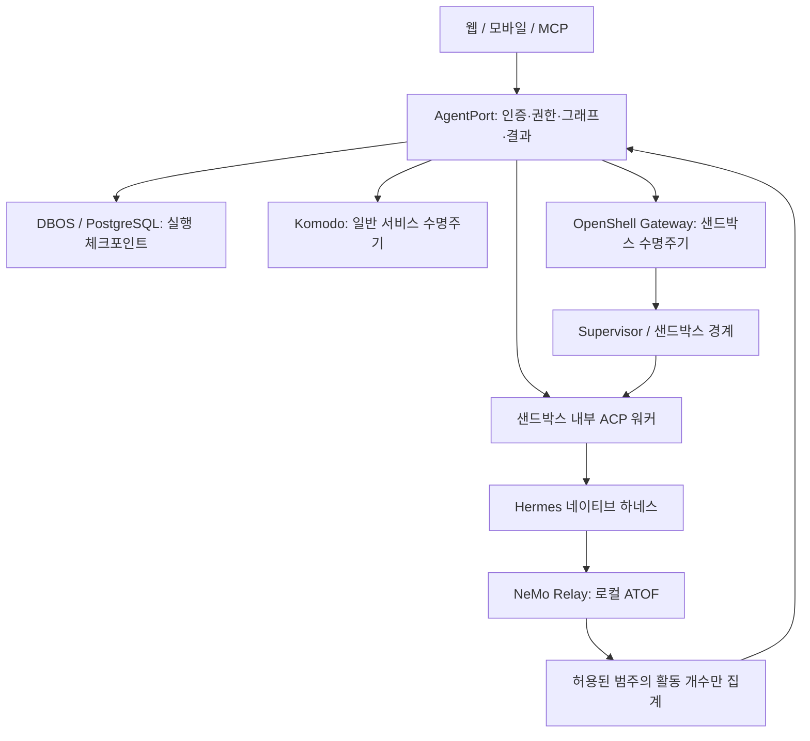

# 실행 플랫폼 개편: OpenShell와 NeMo Relay

AgentPort는 사용자·프로젝트 권한, 명시적 그래프, 에이전트 세션과 결과를 관리합니다. 실행 격리는 OpenShell, 일반 Docker 서비스 운영은 Komodo, 에이전트 내부 관찰은 선택적인 NeMo Relay가 담당합니다. Paperclip은 독립적인 선택 서비스입니다.



## 구현된 변경

- 서비스 정의에 `openshell: {gateway, workspace, sandbox, sandbox_id}`를 추가했습니다. 기존 `stack_id` 정의는 그대로 Komodo로 연결됩니다. 둘을 함께 지정하면 거부합니다.
- 요청 시 기동, 상시 실행, 유휴 중지, 운영자 시작·중지가 같은 수명주기 경로를 사용합니다. OpenShell SDK의 start/stop 후 ready/stopped까지 확인합니다. 단순 RPC 접수를 완료로 처리하지 않습니다.
- `sandbox_id`를 조작 전후에 확인합니다. 이름이 재사용된 샌드박스를 임의로 조작하지 않습니다. 외부 운영자의 동시 삭제·재생성을 원자적으로 막는 것은 아니므로 AgentPort에 맡긴 샌드박스는 단일 관리 주체로 운영해야 합니다.
- `aog_sandbox_bindings`의 고유 제약으로 같은 gateway/workspace/name을 두 서비스에 등록하지 못하게 합니다. 따라서 서로 다른 임대 목록 때문에 사용 중 샌드박스가 종료되는 경로를 막습니다. 같은 실제 gateway를 여러 별칭으로 등록하지 마세요.
- 등록 대상 변경은 중앙 runtime이 stopped이고 활성 임대가 없을 때만 가능합니다. OpenShell 업데이트는 stop/start나 Komodo 이미지 교체로 위장하지 않습니다. 별도 샌드박스를 준비·검증한 뒤 등록을 바꿉니다.
- 운영자용 `GET /orchestration/v1/services/{id}/runtime`과 대시보드의 Check sandbox가 실제 상태를 조회합니다. 일반 사용자는 제어 권한을 받지 않습니다. 상태 조회는 저장된 실행 상태를 임의 변경하지 않습니다.
- Hermes 워커에서 `AOG_RELAY_ENABLED=1`이면 공식 네이티브 Relay 설정을 전달합니다. 로컬 파일 sink만 생성하고 full payload 옵션을 끕니다. 원시 이벤트는 중앙으로 전송하지 않으며, 응답의 `observability`에 agent/turn/tool/llm 시작·종료 개수만 포함합니다. 대시보드 Activity에서 볼 수 있습니다.

## 설치 순서

### 1. 기존 시스템 백업

현재 실행과 불명확 실행을 먼저 정리하고 PostgreSQL·워커 볼륨을 백업합니다. 이번 DB 변경은 신규 binding 테이블 추가이며 기존 서비스 JSON은 기본값으로 읽습니다. 과거 버전으로 돌아가면 OpenShell 서비스 정의를 이해하지 못하므로, 실행을 정리하고 해당 정의를 제거하거나 백업으로 복원한 뒤 내려가야 합니다. 코드만 되돌리는 것을 데이터 복구로 취급하지 않습니다.

### 2. OpenShell 제어 연결

SDK와 Gateway 기준은 **0.1.7**입니다. SDK는 `uv.lock`에 선택 의존성으로 잠겼고 CLI/샌드박스 런타임을 자동 설치하지 않습니다.

```bash
uv sync --frozen --extra openshell
```

운영자가 OpenShell Gateway를 설치하고 서비스용 mTLS 인증서를 준비합니다. 전용 키를 사용하고 gateway 정책에서 필요한 workspace/operation만 허용하세요. `deploy/openshell-gateways.example.json`을 비공개 `gateways.json`으로 복사하고 주소·CA·인증서·키 경로를 채웁니다. 인증서 이름은 예시이며 파일 내용을 저장소에 올리지 않습니다. 읽기 가능한 UID는 gateway의 10001입니다.

Compose 실행 예:

```bash
export AOG_OPENSHELL_CONFIG_DIR=/absolute/private/openshell-config
docker compose -f compose.yaml -f deploy/compose.openshell.yaml up -d --build
```

이 override는 SDK 추가와 읽기 전용 인증 설정 마운트만 수행합니다. OpenShell host 설치, sandbox 생성, host Docker 소켓 전달은 하지 않습니다. 일반 서비스용 기본 Compose는 여전히 OpenShell 없이 실행됩니다. 수명주기 인증 정보는 중앙 운영 영역에만 있고 에이전트 환경에 전달되지 않습니다.

### 3. 워커를 샌드박스 안에 배치

OpenShell 운영 도구로 **사용자 × 프로젝트 × 에이전트** 전용 샌드박스를 준비합니다. 그 이미지에 AgentPort ACP 워커와 선택한 하네스를 설치하고 `uvicorn aog.worker:app --host 0.0.0.0 --port 8090 --workers 1`을 주 프로세스로 실행합니다. Hermes 이미지/런타임 빌드는 별도 운영 준비 사항이며 기본 `deploy/worker.Dockerfile`은 아직 Codex/Claude용입니다.

워커의 `AOG_WORKER_ROOT`는 영속 볼륨이어야 합니다. 중앙 공개 키, 고정 audience, 소유자, 프로젝트를 설정합니다. 파일 import/export와 native session 저장은 모두 샌드박스 내부에서 이뤄지므로 호스트 ACP와 원격 cwd를 억지로 연결하지 않습니다.

워커 HTTP 경로는 운영자가 구성한 사설 프록시/서비스 노출로 연결합니다. 중앙 → 워커의 `X-AOG-Context`, `Idempotency-Key` 전달을 보존해야 합니다. 서비스 노출 자체 인증과 개인 모델 API 인증을 같은 Bearer 헤더로 겹쳐 쓰지 마세요. 별도 프록시·mTLS 등 운영 환경에 맞는 인증을 구성하고 검증해야 합니다. 이번 코드가 임의의 OpenShell ingress를 자동 설정하지는 않습니다.

`examples/openshell-agent.service.json`에서 주소와 실제 sandbox ID를 채운 뒤 읽기 전용 검사:

```bash
export AOG_OPENSHELL_CONFIG=/absolute/private/gateways.json
uv run --extra openshell python scripts/check-openshell.py examples/openshell-agent.service.json
```

정의 파일을 대시보드에 등록하고 우선 manual에서 실제 호출을 확인합니다. ready는 샌드박스 상태이며 worker health는 별도로 확인합니다. 백그라운드 작업·cron·다른 입구 호출이 없고 모든 작업을 중앙 임대로 추적하는 전용 런타임에서만 on_demand로 전환합니다. Hermes daemon이나 Paperclip의 독립 업무가 있으면 중앙 임대만으로 idle을 판단할 수 없으므로 manual/always_on을 사용합니다.

`egress_policy=isolated`는 OpenShell 사용 여부만 보고 설정하지 않습니다. 외부 DNS/HTTPS, 간접 프록시, 네이티브 도구의 통신을 차단한 정책을 실제로 확인한 뒤 표시합니다. 클라우드 모델을 사용하는 하네스는 일반적으로 unrestricted입니다.

### 4. Hermes Relay 활성화

Hermes 네이티브 Relay 지원과 `hermes doctor`의 NeMo Relay Plugins 진단이 있는 버전을 사용합니다. Hermes가 관리하는 Relay 의존성 버전을 따르며 AgentPort가 중앙에 Relay SDK를 강제 설치하지 않습니다. 참고 계약은 NeMo-Relay 소스 `dc00b939ae916266ce4f22ca080c9f13a40d4c48`입니다.

워커 환경에 `AOG_AGENT_PROVIDER=hermes`, `AOG_RELAY_ENABLED=1`을 지정합니다. 워커가 `$AOG_WORKER_ROOT/telemetry/plugins.toml`을 생성하고 `HERMES_NEMO_RELAY_PLUGINS_TOML`로 전달합니다. 워커 전용 Hermes gateway가 기존에 살아 있었다면 작업을 정리하고 해당 gateway만 재시작해야 새 설정을 읽습니다. 공용 프로필·공용 daemon은 사용하지 않습니다. Relay를 끌 때도 플래그만 바꾸면 기존 daemon의 설정은 남을 수 있으므로 해당 전용 gateway를 정리하고 프로필의 Relay 설정을 해제한 뒤 재시작합니다.

- 이벤트는 `telemetry/events.jsonl`에 append됩니다. 전용 디스크 할당량과 보존/회전 정책을 운영자가 설정해야 합니다. 중앙 요약은 최대 2 MB만 읽습니다.
- full payload=false라도 원본 로그에 경로·메타데이터 등 민감정보가 있을 수 있습니다. 별도 접근권한과 백업 정책이 필요합니다. 중앙 집계는 이름·인자·결과·metadata를 버립니다.
- 집계는 **워커 호출 시간 구간**의 활동입니다. 백그라운드 이벤트가 섞이거나 마지막 이벤트가 늦게 flush될 수 있습니다. 정확한 비용·성공 여부·전체 이벤트 수를 보장하지 않습니다. 중앙 실행 결과는 기존 run 권한을 그대로 적용합니다.
- 로그가 없으면 `available=false`로 표시합니다. 설정 완료를 실기 기록 성공으로 표시하지 않습니다. Codex/Claude Relay CLI 결합은 ACP 런처와의 조합 검증 전까지 거부하며, 해당 하네스는 Relay를 끈 상태로 계속 사용할 수 있습니다.
- Relay 설정 파일이 사용자 설정을 대체하더라도 상위 시스템 설정이 적용될 수 있습니다. 이미지에 외부 exporter가 없는지 별도로 점검하세요. Hermes 자체 shared metrics 동의 설정은 Relay 파일 sink와 별개입니다.

## 검증과 남은 범위

실제 OpenShell SDK를 설치하고 모의 로컬 gRPC 서버에 get/start/stop/wait 호출을 검증했습니다. 샌드박스 ID 변경·응답 유실·사용 중 중지 방지·중복 binding 및 기존 사용자 격리 테스트를 포함합니다. Relay는 공식 TOML 형식과 모의 ATOF/ACP 테스트이며 실제 Hermes 모델 실행은 아직 아닙니다.

실제 OpenShell Gateway+mTLS+샌드박스+Hermes+Relay 종단 간 검증, GPU/DGX 실행, 네트워크 정책 침투 검증, 정책 편집 UI, 자동 프로비저닝, native 취소·확정 복구는 남아 있습니다. OpenShell로 관리하는 일반 샌드박스와 NemoClaw가 소유한 샌드박스의 관리 절차도 동일하지 않습니다. NemoClaw 소유 리소스를 이 backend로 우회 관리하지 마세요.

AgentPort 장애 시 새 외부 호출을 자동 차단하는 기능은 이번 개편에 포함되지 않습니다. OpenShell supervisor 연결 보장과 AgentPort 연결 상태는 다릅니다. 이를 보장하려면 실행 허가 갱신과 네트워크 경로 차단을 검증해야 하며, Relay 로그를 재실행 근거로 삼지 않습니다. DBOS와 외부 상태 대조 계약은 계속 유지합니다.

참조: [OpenShell 0.1.7 Python SDK](https://github.com/NVIDIA/OpenShell/blob/v0.1.7/docs/sdk/python.mdx), [OpenShell 아키텍처](https://docs.nvidia.com/openshell/v0.1.7/about/architecture), [Relay Hermes 연결](https://github.com/NVIDIA/NeMo-Relay/blob/dc00b939ae916266ce4f22ca080c9f13a40d4c48/docs/getting-started/quick-start/hermes.mdx). SDK/설정 계약을 사용하며 상류 엔진 코드를 복사하지 않습니다.
